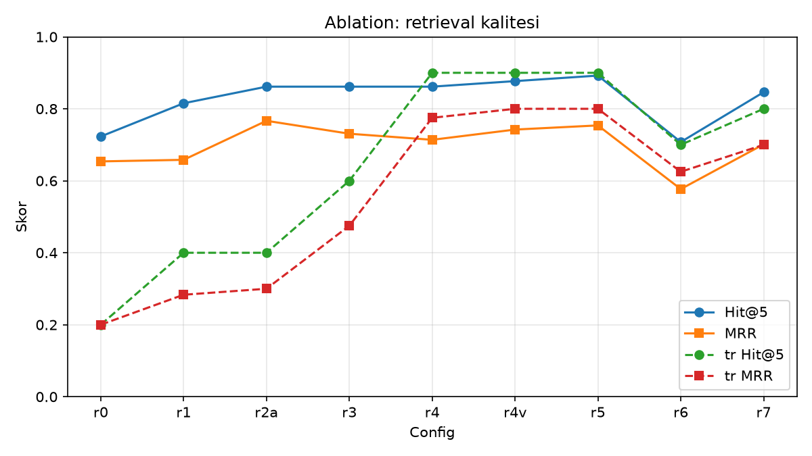

# Değerlendirme sonuçları

## Retrieval (sayfa bazlı, k=5)

| Config | Hit@5 | Recall@5 | MRR | nDCG@5 | tr Hit@5 | ms/soru |
|---|---|---|---|---|---|---|
| r0 | 0.723 | 0.674 | 0.654 | 0.641 | 0.200 | - |
| r1 | 0.815 | 0.751 | 0.658 | 0.658 | 0.400 | - |
| r2a | 0.862 | 0.797 | 0.767 | 0.745 | 0.400 | 0.5 |
| r3 | 0.862 | 0.808 | 0.731 | 0.725 | 0.600 | - |
| r4 | 0.862 | 0.772 | 0.714 | 0.697 | 0.900 | - |
| r4v | 0.877 | 0.803 | 0.742 | 0.726 | 0.900 | 706.7 |
| r5 | 0.892 | 0.810 | 0.754 | 0.735 | 0.900 | 8447.9 |
| r6 | 0.708 | 0.654 | 0.577 | 0.574 | 0.700 | 5.8 |
| r7 | 0.846 | 0.764 | 0.701 | 0.683 | 0.800 | 1675.4 |

r4, r4v ve r5 bu tabloda rewrite/rerank için yerel `llama3.2` ile, r7 ise Groq `gpt-oss-20b` ile ölçüldü; tam değerlendirme tablosu da Groq modelleriyle. Bu ölçümler birbirine birebir kıyaslanmamalı. r6 (yalnız BM25) ve r7 (BM25 + yeniden yazma) canlı sitenin kullandığı vektörsüz yoldur. Out-of-scope sorular retrieval skoruna girmez (n=65).

## Tam hat (cevap + judge)

| Config | Accuracy | Faithfulness | Kaynak doğr. | Red doğruluğu | Cevaplanan | ms/soru | LLM çağrısı |
|---|---|---|---|---|---|---|---|
| r0 | 4.46 | 4.90 | 0.885 | 0.838 | 0.80 | 1022 | 1.0 |
| r4v | 4.56 | 4.92 | 0.915 | 0.925 | 0.91 | 1384 | 1.9 |
| r7 | 4.45 | 4.84 | 0.839 | 0.963 | 0.95 | 1492 | 1.9 |

Accuracy ve faithfulness yalnız cevaplanan sorular üzerinden hesaplanır; judge bir LLM'dir.
